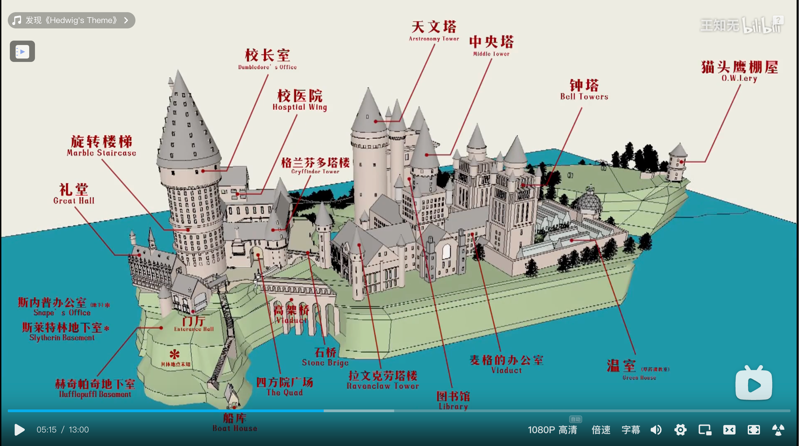

# 霍格沃茨建筑名称与相对位置

下文的建筑位置表主要依据青蛙刀圣1993 的《魔法世界城堡指南【路痴福音】》，全长约 16 分 57 秒。已梳理全片字幕，并用 Chrome 的 1920 × 1080 播放画面核对标注和关键镜头。视频作者以电影终章为主，混用早期电影、小说、Minecraft 复原和《哈利波特：魔法觉醒》内测画面。下表第一列是供项目后续统一的建议名，第二列保留视频原称。位置按各来源的相邻关系记录，方位仅用于有明确方向说明的版本。 [视频原片](https://www.bilibili.com/video/BV1z64y1r7zH/) · [作者说明所用版本 00:18](https://www.bilibili.com/video/BV1z64y1r7zH/?t=18) · [Stuart Craig 谈电影布局演变](https://www.harrypotter.com/features/designing-hogwarts-castle)

## 城堡建筑标注图

用户提供的 B 站视频截图，画面水印为「王知无」，播放器时间为 05:15（全长 13:00）。可沿图中的引线对照礼堂与门厅、崖下船库以及石桥和高架桥的相对位置。带星号的地点保留图中「具体地点未知」的说明。 [B 站原视频 05:15](https://www.bilibili.com/video/BV1Rb411c7vn/?t=315)

## 湖岸、大礼堂与入口

| 建议名 | 视频原称 | 位置与版本 | 回看 |
| --- | --- | --- | --- |
| 船屋（Boathouse） | 船屋、Boat House、小船屋 | 湖岸、城堡崖脚。新生乘船登岸后从这里上崖，终章也可见从礼堂前庭一侧下到船屋的路线。 | [00:51](https://www.bilibili.com/video/BV1z64y1r7zH/?t=51) · [06:48](https://www.bilibili.com/video/BV1z64y1r7zH/?t=408) |
| 悬崖楼梯 | 楼梯、悬崖楼梯 | 船屋和礼堂入口之间的折返石阶，沿崖升至入口层。与主塔内的大楼梯是不同路线。 | [00:54](https://www.bilibili.com/video/BV1z64y1r7zH/?t=54) · [06:52](https://www.bilibili.com/video/BV1z64y1r7zH/?t=412) |
| 入口厅（Entrance Hall） | 入口厅 | 早期电影里的室内门厅，上完悬崖楼梯后到达，进去通往大礼堂。官方设定也确认两厅相邻。 | [00:57](https://www.bilibili.com/video/BV1z64y1r7zH/?t=57) · [官方大礼堂条目](https://www.harrypotter.com/fact-file/locations/the-great-hall) |
| 大礼堂前庭（Entrance Courtyard） | 入口厅、露天回型廊 | 后期电影里大礼堂门外的露天前庭。终章俯视标出两个通路，正门石桥接一边，船屋方向的悬崖楼梯接另一边。作者从第 4 部起识别为露天形式，Craig 证实前庭后来增建并逐步扩大。 | [02:15](https://www.bilibili.com/video/BV1z64y1r7zH/?t=135) · [02:30](https://www.bilibili.com/video/BV1z64y1r7zH/?t=150) · [Craig 访谈](https://www.architecturaldigest.com/story/harry-potter-set-design-article) |
| 大礼堂（Great Hall） | 礼堂、霍格沃茨礼堂 | 临湖岩台上的长形建筑，紧挨入口厅和主塔。早期从入口厅进入，终章的前庭也直接通向礼堂大门。 | [01:04](https://www.bilibili.com/video/BV1z64y1r7zH/?t=64) · [02:33](https://www.bilibili.com/video/BV1z64y1r7zH/?t=153) |
| 主塔（Main Tower） | 主塔 | 大礼堂旁的大圆塔，也是视频标出的四角院角塔。作者把塔内大楼梯视作通往校内各处的交通节点。前一份建筑笔记称其为「大圆塔」。 | [01:18](https://www.bilibili.com/video/BV1z64y1r7zH/?t=78) · [02:42](https://www.bilibili.com/video/BV1z64y1r7zH/?t=162) |
| 校长办公室（Headmaster’s Office） | 邓布利多办公室、校长办公室 | 视频将办公室定位在主塔顶端附属的小塔组。办公室、起居室和旋转楼梯分别对应哪座小塔，是作者根据镜头的推测。 | [01:27](https://www.bilibili.com/video/BV1z64y1r7zH/?t=87) · [01:43](https://www.bilibili.com/video/BV1z64y1r7zH/?t=103) |

## 四角院、钟塔与教学区

| 建议名 | 视频原称 | 位置与版本 | 回看 |
| --- | --- | --- | --- |
| 四角院（Quadrangle） | 回型院、四角院、主塔四角院 | 位于主塔背后，主塔占一角，格兰芬多塔在斜对角。校医室位于这一组楼体的上层，教学楼群与这组院落相邻。 | [02:39](https://www.bilibili.com/video/BV1z64y1r7zH/?t=159) · [04:09](https://www.bilibili.com/video/BV1z64y1r7zH/?t=249) · [04:48](https://www.bilibili.com/video/BV1z64y1r7zH/?t=288) |
| 校医院（Hospital Wing） | 校医室 | 四角院上层的高窗楼翼，经走廊连钟塔。《阿兹卡班的囚徒》的飞行与走廊镜头用来核对它的位置。 | [02:57](https://www.bilibili.com/video/BV1z64y1r7zH/?t=177) · [03:08](https://www.bilibili.com/video/BV1z64y1r7zH/?t=188) |
| 钟塔（Clock Tower） | 钟塔楼 | 接在校医院外侧，与钟塔庭院相邻。大钟盘和钟摆是识别标志。 | [03:17](https://www.bilibili.com/video/BV1z64y1r7zH/?t=197) · [04:06](https://www.bilibili.com/video/BV1z64y1r7zH/?t=246) |
| 钟塔庭院（Clock Tower Courtyard） | 钟塔院 | 钟塔外侧有回廊与中央水景的露天院子，外端接木廊桥。视频把这条出校路线称为西门，也用于去霍格莫德村。 | [03:22](https://www.bilibili.com/video/BV1z64y1r7zH/?t=202) · [03:35](https://www.bilibili.com/video/BV1z64y1r7zH/?t=215) |
| 木廊桥（Wooden Bridge） | 木桥、学校西门 | 从钟塔庭院跨谷通向校外。华纳的布景说明把另一端定位在去海格小屋路上的石圈附近。 | [03:34](https://www.bilibili.com/video/BV1z64y1r7zH/?t=214) · [03:56](https://www.bilibili.com/video/BV1z64y1r7zH/?t=236) · [华纳木桥布景](https://www.wbstudiotour.co.uk/the-experience/explore-the-tour/sets/the-hogwarts-bridge/) |
| 格兰芬多塔（Gryffindor Tower） | 格兰芬多塔、格兰芬多宿舍 | 视频用俯视镜头和复原模型把它定位在四角院中与主塔斜对角的一座尖顶塔。休息室和宿舍是塔内地点，休息室经胖夫人画像进入。 | [04:10](https://www.bilibili.com/video/BV1z64y1r7zH/?t=250) · [07:52](https://www.bilibili.com/video/BV1z64y1r7zH/?t=472) |
| 教学楼（Teaching Block） | 教学楼 | 视频对四角院邻侧另一组教室楼翼的统称，临教学楼草坪。早期电影画面以石拱桥连接这组楼翼与大礼堂入口一侧。 | [04:29](https://www.bilibili.com/video/BV1z64y1r7zH/?t=269) · [04:48](https://www.bilibili.com/video/BV1z64y1r7zH/?t=288) |
| 教学楼草坪（Teaching Courtyard） | 教学楼草坪、草坪 | 教学楼之间的草地院落，旁边有拱廊。《混血王子》的镜头从天文塔俯看这处院落。 | [04:40](https://www.bilibili.com/video/BV1z64y1r7zH/?t=280) · [05:41](https://www.bilibili.com/video/BV1z64y1r7zH/?t=341) |
| 温室（Greenhouses） | 温室 | 视频的积木模型标在教学楼群外缘、沿岩台布置。影棚全景也能看到长翼楼旁的温室群。 | [07:19](https://www.bilibili.com/video/BV1z64y1r7zH/?t=439) · [影棚全景](https://commons.wikimedia.org/wiki/File:Studio_model_of_Hogwarts_at_Leavesden_Studios.jpg) |
| 变形课教室 | 变形课教室 | 位于教学区。视频沿《魔法石》里哈利和罗恩的行进方向解读为过桥后从拱廊右转，随后可看到临草坪的走廊。 | [04:48](https://www.bilibili.com/video/BV1z64y1r7zH/?t=288) · [04:58](https://www.bilibili.com/video/BV1z64y1r7zH/?t=298) |
| 小天狼星关押塔（描述名） | 关小天狼星的塔 | 第 3 部里，视频将这座圆塔定位在教学楼草坪旁。Craig 确认第 3 部有这座塔，后续电影移除了它。 | [05:13](https://www.bilibili.com/video/BV1z64y1r7zH/?t=313) · [Craig 访谈](https://www.architecturaldigest.com/story/harry-potter-set-design-article) |
| 天文塔（Astronomy Tower） | 天文塔、天文塔楼、天文台 | 第 6 部的大塔，邻接教学楼和草坪。视频把它与第 3 部关押塔作前后对照，Craig 确认两座塔设计不同，具体塔基是否重合仍待核对。 | [05:23](https://www.bilibili.com/video/BV1z64y1r7zH/?t=323) · [05:41](https://www.bilibili.com/video/BV1z64y1r7zH/?t=341) · [Craig 访谈](https://www.architecturaldigest.com/story/harry-potter-set-design-article) |
| 教学石桥（早期） | 教学石桥、石桥 | 早期电影里的跨谷石拱桥，连接入口一侧与教学楼。用两端的建筑辨认。 | [04:48](https://www.bilibili.com/video/BV1z64y1r7zH/?t=288) · [06:24](https://www.bilibili.com/video/BV1z64y1r7zH/?t=384) |
| 正门石桥（Viaduct，终章） | （新）石桥、正门的石桥 | 从校外跨谷直达大礼堂前庭。作者以桥位变化解释早期和终章的画面，终章视效主管称终章桥为新建的高架桥。两处各自保留所对应的影片版本。 | [06:28](https://www.bilibili.com/video/BV1z64y1r7zH/?t=388) · [终章视效访谈](https://www.awn.com/vfxworld/potter-finale-fit-wizard) |

## 校园外围

| 建议名 | 视频原称 | 位置与版本 | 回看 |
| --- | --- | --- | --- |
| 黑湖（Black Lake） | 湖 | 位于礼堂崖脚与车站一侧之间，船屋在城堡侧岸边。视频的校区示意图以湖作为入学路线的参照。 | [00:32](https://www.bilibili.com/video/BV1z64y1r7zH/?t=32) |
| 霍格莫德车站（Hogsmeade Station） | 霍格莫德车站 | 在视频示意图的校区南侧。一年级学生在此下车后渡湖。 | [00:35](https://www.bilibili.com/video/BV1z64y1r7zH/?t=35) |
| 霍格莫德村（Hogsmeade） | 霍格莫德魔法村 | 视频按第 3 部的镜头说明，从钟塔庭院集合，过木廊桥向校外走可以前往村子。 | [03:36](https://www.bilibili.com/video/BV1z64y1r7zH/?t=216) |
| 猫头鹰塔（Owlery） | 猫头鹰塔 | 作者把电影中的独立塔标在建筑群西侧，从木桥出校右转。官方设定称 Owlery 位于 West Tower 顶部，具体塔体按所选版本校对。 | [05:47](https://www.bilibili.com/video/BV1z64y1r7zH/?t=347) · [05:53](https://www.bilibili.com/video/BV1z64y1r7zH/?t=353) · [官方猫头鹰棚条目](https://www.harrypotter.com/fact-file/locations/owlery) |
| 魁地奇球场（Quidditch Pitch） | 魁地奇球场 | 视频复原图中在猫头鹰塔以北。《魔法觉醒》飞行段落称球场位于城堡西北侧。 | [06:04](https://www.bilibili.com/video/BV1z64y1r7zH/?t=364) · [08:59](https://www.bilibili.com/video/BV1z64y1r7zH/?t=539) |
| 打人柳（Whomping Willow） | 打人柳 | 视频的第一部参考图把它放在城堡东侧、靠禁林方向。 | [06:08](https://www.bilibili.com/video/BV1z64y1r7zH/?t=368) |
| 海格小屋（Hagrid’s Hut） | 海格小屋 | 第一部参考图标在城堡东侧的禁林边。图注说明后续电影另有西侧版本，定位时需注明影片。 | [06:11](https://www.bilibili.com/video/BV1z64y1r7zH/?t=371) |
| 禁林（Forbidden Forest） | 禁林、禁忌之森 | 第一部参考图中在海格小屋附近。视频后段在《魔法觉醒》画面中称禁林在东北方向。 | [06:14](https://www.bilibili.com/video/BV1z64y1r7zH/?t=374) · [15:56](https://www.bilibili.com/video/BV1z64y1r7zH/?t=956) |

## 室内地点补充

| 建议名 | 相对位置及证据 | 回看 |
| --- | --- | --- |
| 斯莱特林公共休息室 | 从入口厅一带下行至地牢层。视频旁白说左侧，屏幕引用的小说段落从人物视角说右侧，门朝向待定。官方确认休息室在地牢。 | [07:58](https://www.bilibili.com/video/BV1z64y1r7zH/?t=478) · [学院官方资料](https://www.harrypotter.com/house/slytherin) |
| 赫奇帕奇公共休息室 | 地下一层，与学校厨房位于同一条走廊。视频在该段讨论的是小说设定。 | [08:07](https://www.bilibili.com/video/BV1z64y1r7zH/?t=487) · [学院官方资料](https://www.harrypotter.com/house/hufflepuff) |
| 拉文克劳塔与公共休息室 | 休息室位于拉文克劳塔顶部。视频展示游戏室内，塔在外景中的具体位置待定位。 | [08:16](https://www.bilibili.com/video/BV1z64y1r7zH/?t=496) · [官方休息室条目](https://www.harrypotter.com/fact-file/locations/the-ravenclaw-common-room) |
| 斯内普办公室 | 作者在积木模型上把《凤凰社》中的办公室标在教学石桥靠教学楼一端的塔脚。具体入口和楼层待定位。 | [07:26](https://www.bilibili.com/video/BV1z64y1r7zH/?t=446) |
| 黑魔法防御术教室与教授办公室 | 视频以电影内景作对照，教室最深处的楼梯通往任课教授办公室。所在楼翼待定位。 | [13:18](https://www.bilibili.com/video/BV1z64y1r7zH/?t=798) |
| 桃金娘的盥洗室 | 视频称位于二楼。此处保留视频楼层口径，项目楼层编号和所属楼翼待核对。 | [15:53](https://www.bilibili.com/video/BV1z64y1r7zH/?t=953) |

《魔法觉醒》画面还出现了魔咒课、决斗俱乐部和图书馆的入口标签，可用于核对游戏内的称呼。电影版的对应入口和楼层待核对。 [游戏飞行 08:45](https://www.bilibili.com/video/BV1z64y1r7zH/?t=525) · [游戏地图 09:27](https://www.bilibili.com/video/BV1z64y1r7zH/?t=567)

## 与现有项目对照

| 项目中的名称或位置 | 后续统一时的对应关系 |
| --- | --- |
| `Castle Grounds` / `exterior` | 步行从礼堂前庭靠外侧的回廊内开始。 [室外区域代码](../src/world/zones/CastleGroundsZone.ts) |
| `Great Hall` / `great_hall` | 从前庭尽端进门，上门厅内阶，到第二道门按 E 进入礼堂。室内与外景共用门厅和内阶尺寸。 [室内区域代码](../src/world/zones/GreatHallZone.ts) · [礼堂组装](../src/world/generators/GreatHallArchitecture.ts) |
| `ENTRANCE_COURTYARD` | 回廊按 Andy 模型的比例调整为约 18.6 × 24，进深 2.9。正边有七个透空花格拱，两侧分别接崖梯和高架桥。 [前庭组装](../src/world/generators/EntranceCourtyard.ts) |
| `CASTLE_APPROACH` | 前庭中轴为 `x=-39.5`，地面为 `y=32`，范围为 `z=-8.24…15.76`。礼堂本体山墙在 `z=19`，外门槛升高 0.54，门厅内阶再升高 1.44。 [共享坐标](../src/world/castleLayout.ts) |
| `BOATHOUSE` / `CLIFF_STAIR_TURNS` | 从前庭左侧拱门沿石阶和折返平台下至船屋的靠崖后门。船口向外斜开至黑湖。模型和步行碰撞共用转折点和平台轮廓。 [船屋组装](../src/world/generators/Boathouse.ts) · [崖梯组装](../src/world/generators/CliffStaircase.ts) |

建模时可用 [04:44 的标注总览](https://www.bilibili.com/video/BV1z64y1r7zH/?t=284) 对齐三组建筑的邻接关系，再用 [伦敦影棚模型原图](hogwarts-architecture-references.md#伦敦-leavesden-模型原图) 对齐岩台、桥跨和塔楼轮廓。图中的北向箭头和左右转只对应当时的复原图或行进镜头，项目坐标与这套方位的对应关系待确认。

前庭两侧通路按影棚扫描与终章俯视镜头接入。用户提供的 GLB 用于参考长窄的礼堂轮廓、十二开间的双层尖窗、阶梯形山墙、屋脊尖饰及临崖矮塔。前庭比例、门厅内阶、礼堂铺地、桌椅和玻璃参照 Andy 的模型。 [终章前庭与两处入口](https://www.bilibili.com/video/BV1z64y1r7zH/?t=147) · [Jzax 的 GLB](https://sketchfab.com/3d-models/hogwarts-school-no-terrain-8c5af96a404040c8b42ca628a3c7c867) · [Andy 的礼堂与前庭](hogwarts-architecture-references.md#andy-版前庭与礼堂室内)

礼堂尖塔的比例以 Leavesden 影棚照片校对。中央尖塔高而细，两端的尖塔由石砌塔身托起，邻接大圆塔的锥顶约占塔体总高的四成半。项目尺寸取自照片中的相对比例。 [影棚全景](https://commons.wikimedia.org/wiki/File:Studio_model_of_Hogwarts_at_Leavesden_Studios.jpg) · [礼堂近景](https://commons.wikimedia.org/wiki/File:Hogwarts_Castle_(6973114630).jpg)

临崖矮塔与前庭回廊相接，圆形塔身上有窄窗，锥顶檐口高出回廊屋面。礼堂门楼从本体向前突出约 4.7 米，侧墙有窄尖窗，上方斜屋面接回本体山墙。门楼正面有深钟龛、附墙尖塔和小尖拱门亭，右侧屋翼有带两道横档的长窗。门楼进深由扫描侧视估算。回廊外侧尖拱补有石花格，通往崖梯的侧门保持通行。 [影棚扫描](https://sketchfab.com/3d-models/hogwarts-model-scan-warner-bros-studio-fb7143080e4e4b6abd4a5620f6b56436)

船屋造型以用户提供的影棚扫描近景为准：短而低的石墙、连续的陡坡瓦面、临水高尖拱，以及贴着山墙的八角尖塔。塔身开窄尖窗，锥顶只有一处小老虎窗。以 [Mosyan 扫描俯视](https://sketchfab.com/3d-models/hogwarts-model-scan-warner-bros-studio-fb7143080e4e4b6abd4a5620f6b56436) 核对船口和礼堂纵轴的夹角，以及末段崖梯如何接到后门。Jzax GLB 仅用于估算相对位置和占地；项目角度与尺寸是按参考对齐的近似值。

崖梯按扫描的俯视轮廓调整折返方向，侧视用于区分直梯与平段，并核对三个突出的圆转台、挡土墙和低护墙压顶。现有前庭侧门到船屋后门落差约 31 米，高差分配和踏步数量按项目尺度估算。 [影棚扫描](https://sketchfab.com/3d-models/hogwarts-model-scan-warner-bros-studio-fb7143080e4e4b6abd4a5620f6b56436)
